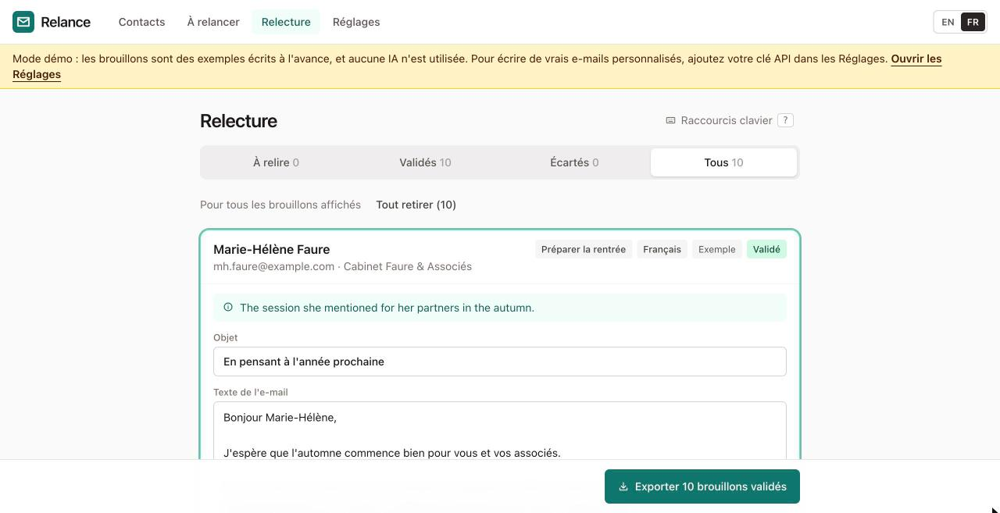

# Relance

**Écrivez des e-mails de suivi personnels aux personnes avec qui vous travaillez, au bon moment de l'année, sans tout rédiger vous-même, et sans confier votre liste de contacts à qui que ce soit.**

[English](README.md) · **Essayer maintenant : https://felariop-jpg.github.io/relance/** (sans compte ni carte bancaire ; démarre en mode démo)

## De quoi s'agit-il

Relance est un petit outil pour les consultants et les dirigeants de petites entreprises qui gardent le contact avec leurs clients, leurs prospects et les personnes rencontrées lors d'événements, quelques fois par an.

- **Il vous dit qui relancer.** Chaque modèle a un calendrier simple, par exemple « août, clients sans contact depuis 60 jours ». La page *À relancer* indique qui cela concerne aujourd'hui.
- **Il rédige un brouillon pour chaque personne**, dans sa langue (français ou anglais), à partir de ce que vous avez noté sur elle. Chaque e-mail doit donner l'impression d'avoir été écrit pour cette seule personne.
- **Vous gardez la main.** Vous relisez et modifiez chaque brouillon, vous le validez puis vous l'exportez. Vous l'envoyez vous-même depuis Outlook ou votre messagerie habituelle.

## Trois promesses

1. **Relance n'envoie jamais d'e-mail.** Il n'en a pas la possibilité : il ne contient aucun code d'envoi, même désactivé. Il prépare des brouillons ; c'est vous qui cliquez sur Envoyer. C'est un choix délibéré.
2. **Vos contacts restent sur votre ordinateur.** Pas de serveur, pas de base de données, pas de compte. Tout est enregistré dans votre navigateur. Relance ne se connecte qu'au service d'IA, et seulement quand vous demandez des brouillons.
3. **L'IA en voit le moins possible, et vous pouvez le vérifier.** Pour chaque brouillon, elle reçoit uniquement le prénom, l'entreprise, le pays, la langue, le type de contact, le travail réalisé ensemble, le lieu de rencontre, ce qui est resté en suspens et vos notes. Jamais le nom de famille, l'adresse e-mail ou le numéro de téléphone. Chaque brouillon a un panneau « Ce qui a été envoyé à l'IA ». Voir [PRIVACY.fr.md](PRIVACY.fr.md).

## Pour commencer

1. Ouvrez **https://felariop-jpg.github.io/relance/**.
2. Suivez l'accueil en trois étapes, ou passez-le.
3. Chargez les contacts d'exemple pour essayer, ou importez votre propre tableur.

Guide pas à pas : **[Premiers pas](docs/getting-started.fr.md)** · Autres guides : [Obtenir une clé API](docs/api-key.fr.md) · [Modifier les modèles](docs/templates.fr.md) · [Confidentialité](PRIVACY.fr.md)

## Combien ça coûte

Relance est gratuit. La rédaction avec l'IA utilise votre propre clé API Anthropic, que vous payez directement à Anthropic : moins d'**un centime d'euro par e-mail** (environ 0,009 € aux prix actuels). Relance affiche une estimation avant chaque lot, le coût réel ensuite, et un total dans les Réglages. Sans clé, Relance fonctionne en mode démo, et vous pouvez toujours écrire des e-mails à partir du texte des modèles, gratuitement.

La partie technique (installation pour développeurs) se trouve dans le [README en anglais](README.md#for-developers).
