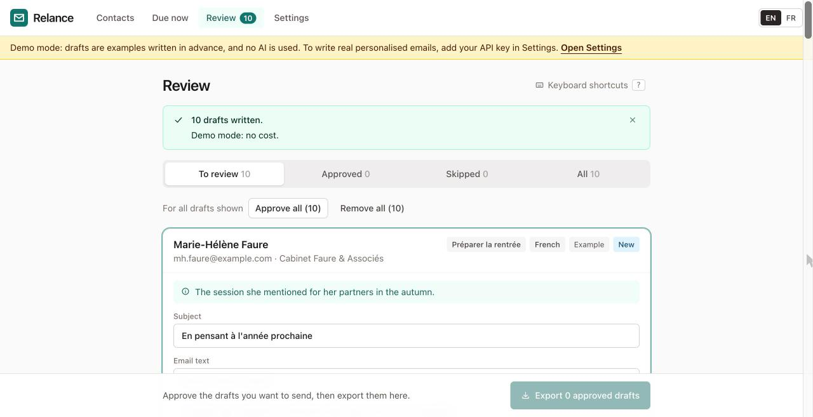
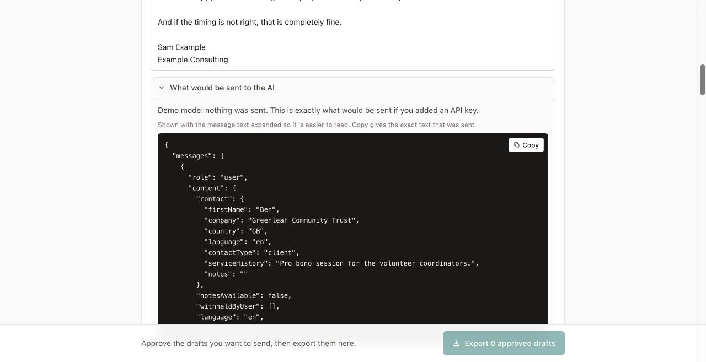
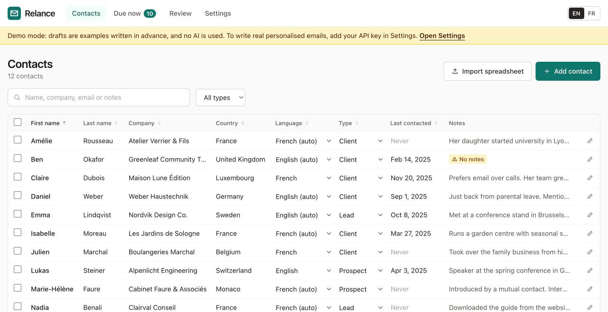
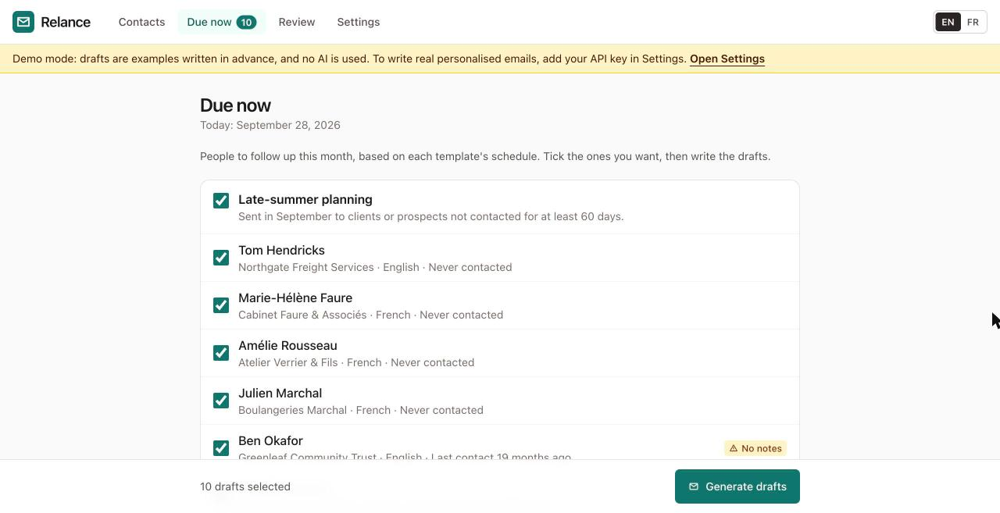
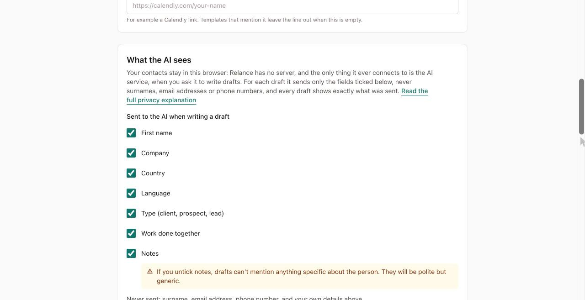
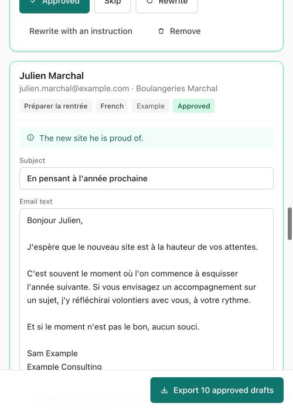

# Relance

**Write personal follow-up emails to the people you work with, at the right time of year, without writing each one from scratch, and without giving your contact list to anyone.**

[Français](README.fr.md) · **Try it now: https://felariop-jpg.github.io/relance/** (no account, no card; it starts in demo mode)



## What it is

Relance is a small tool for consultants and small business owners who keep in touch with clients, prospects and people they met at events, a few times a year.

- **It tells you who is due.** Each template has a simple schedule, for example "August, clients not contacted for 60 days". The *Due now* page lists who that means today.
- **It writes a draft for each person**, in their language (English or French), using what you noted about them. Every email should read as if you wrote it to that one person, because that is what people respond to.
- **You stay in charge.** You read and edit every draft, approve it, and export it. You send it yourself from Outlook or your usual email program.

## Three promises

1. **Relance never sends email.** It has no way to: there is no email-sending code in it at all, not even switched off. It produces drafts; you press Send. This is a deliberate design decision. A tool that could send on its own could also send the wrong thing to the wrong person.
2. **Your contacts stay on your computer.** There is no server, no database and no account. Everything is stored in your web browser. The only thing Relance ever connects to is the AI service, and only when you ask for drafts.
3. **The AI sees as little as possible, and you can check.** For each draft it receives only first name, company, country, language, contact type, what you did together, where you met, what was left open and your notes. It never receives surnames, email addresses or phone numbers. Every draft has a "What was sent to the AI" panel showing exactly what left your browser. See [PRIVACY.md](PRIVACY.md).



## Who it is for

Anyone who follows up with a few dozen or a few hundred people by hand and wants it to be regular and personal. It knows nothing about your line of work: contacts are simply *clients*, *prospects* or *leads*, and the five built-in templates are generic: spring check-in, late-summer planning, holiday greeting, re-engagement and post-event follow-up. You can edit all of them.

## How to start

1. Open **https://felariop-jpg.github.io/relance/**.
2. Follow the three-step welcome, or skip it.
3. Load the sample contacts to try it, or import your own spreadsheet.

Step-by-step guide: **[Getting started](docs/getting-started.md)** · **[Premiers pas](docs/getting-started.fr.md)**

**Handing over?** Print the **[one-page guide](docs/handover.md)** · **[guide en une page](docs/handover.fr.md)** for the person who will use Relance.

Other guides: [Getting an API key](docs/api-key.md) · [Editing templates](docs/templates.md) · [Privacy](PRIVACY.md) · [All guides](docs/README.md)

## What it costs

Relance itself is free. Writing drafts with AI uses your own Anthropic API key, which you pay Anthropic for directly: less than **one euro cent per email** (about €0.009 at current prices). Relance shows an estimate before each batch, the real cost after, and a running total in Settings. Without a key, Relance runs in demo mode with example drafts, and you can still write emails from the template text at no cost.

| | |
|---|---|
|  |  |
|  |  |

---

## For developers

Everything below is for people who want to change or host Relance. You do not need any of it to use the app.

**Stack:** Vite, React 18, TypeScript, Tailwind CSS, Dexie (IndexedDB), PapaParse, react-i18next, zod, fflate, the Anthropic TypeScript SDK (loaded only when a draft is written), Vitest.

```sh
npm install
npm run dev        # http://localhost:5173
npm test           # unit tests, including the privacy and no-send guards
npm run build      # static site in dist/, deployable anywhere
```

- **Deploying:** `.github/workflows/deploy.yml` tests, builds and publishes `dist/` to GitHub Pages on every push to `main`. The build is plain static files with relative paths (one `BASE_PATH` constant), so any static host works. The user guides are built into the site under `docs/`. See [docs/deployment.md](docs/deployment.md), including hosting from a private repository and moving to Cloudflare Pages.
- **Changing the AI model** is a one-line change: `MODEL` in [`src/ai/model.ts`](src/ai/model.ts). Update the price constants next to it, and regenerate the prompt snapshot (see CONTRIBUTING).
- **Privacy is enforced in code:** [`redactForApi`](src/ai/redact.ts) builds the payload from an allowlist, so a new contact field is never sent unless someone adds it on purpose. The production build ships a Content-Security-Policy that lets the browser connect only to the site itself and `api.anthropic.com`.
- **Project rules** for contributors (and AI assistants) are in [CLAUDE.md](CLAUDE.md). How to contribute: [CONTRIBUTING.md](CONTRIBUTING.md).

Licence: [MIT](LICENSE).
