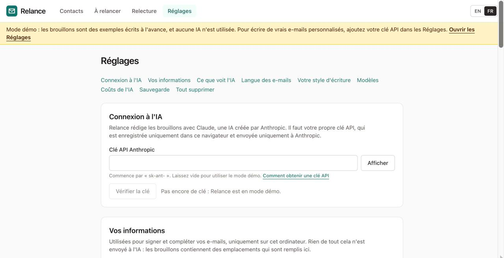

# Obtenir une clé API

*English version: [Getting an API key](api-key.md)*

## Pourquoi Relance en a besoin

Relance rédige les brouillons avec Claude, une IA créée par l'entreprise Anthropic. Relance n'a ni serveur ni compte : il ne peut pas payer l'IA à votre place. Vous connectez donc votre propre compte Anthropic grâce à une **clé** : un long code qui commence par `sk-ant-`. Elle fonctionne comme un mot de passe qui permet à Relance de demander des brouillons à Claude, facturés sur votre compte.

Vous n'avez pas besoin de clé pour essayer Relance. Sans clé, il fonctionne en **mode démo** avec des brouillons d'exemple, et vous pouvez toujours écrire des e-mails à partir du texte des modèles, gratuitement.

## Combien ça coûte

- Relance est gratuit.
- Anthropic facture chaque brouillon rédigé par l'IA. Avec le modèle utilisé par Relance, un e-mail coûte bien moins d'**un centime d'euro** (environ 0,006 €). Un lot de 50 e-mails coûte environ 30 centimes.
- Anthropic facture en dollars américains (2 $ par million de jetons lus, 10 $ par million de jetons écrits, pour le modèle utilisé par Relance). Relance affiche les coûts en euros avec un taux de change fixe : ce sont donc des estimations proches ; votre compte Anthropic indique le montant exact.
- Anthropic vous demande d'acheter du crédit à l'avance. Le montant minimum est de quelques euros, ce qui suffit pour des centaines d'e-mails.
- Relance affiche une estimation avant chaque lot, le coût réel ensuite, et un total dans **Réglages → Coûts de l'IA**.

Les prix peuvent changer. Le site d'Anthropic indique les prix actuels.

## Obtenir une clé, étape par étape

1. Allez sur **console.anthropic.com**. C'est le site d'Anthropic pour les personnes qui utilisent son IA dans d'autres outils (le site est en anglais).
2. Créez un compte, ou connectez-vous si vous en avez déjà un.
3. Ouvrez **Billing** (facturation) et ajoutez du crédit. Quelques euros suffisent pour commencer.

   > TODO (capture d'écran) : la page Billing de la console Anthropic.

4. Ouvrez **API Keys** (clés API).
5. Cliquez sur **Create Key** (créer une clé).
6. Donnez-lui un nom que vous reconnaîtrez, par exemple « Relance ».
7. Validez. La clé n'est affichée **qu'une seule fois**.
8. Cliquez sur le bouton de copie à côté de la clé.

   > TODO (capture d'écran) : une clé nouvellement créée avec son bouton de copie.

9. Ouvrez Relance et cliquez sur **Réglages**.
10. Collez la clé dans **Clé API Anthropic**.
11. Cliquez sur **Vérifier la clé**. Le message « La clé fonctionne. » doit s'afficher.

    

Le bandeau jaune « Mode démo » disparaît. Les brouillons sont désormais rédigés par l'IA.

## Protéger votre clé

- **Votre clé ne quitte votre navigateur que pour aller chez Anthropic.** Relance l'enregistre uniquement dans ce navigateur. Elle est envoyée à Anthropic avec chaque demande : c'est ainsi qu'Anthropic sait que la demande vient de vous. Elle n'est envoyée nulle part ailleurs, et elle n'est pas incluse dans les fichiers de sauvegarde de Relance.
- **Ne la partagez pas.** Toute personne qui a votre clé peut utiliser votre crédit.
- **Fixez une limite de dépenses.** Dans la console Anthropic, sous Billing ou Limits, vous pouvez plafonner les dépenses mensuelles.
- **Si vous pensez que quelqu'un d'autre a votre clé**, allez dans **API Keys** dans la console et supprimez-la, puis créez-en une nouvelle et collez-la dans Relance.
- **Sur un ordinateur partagé**, n'oubliez pas que toute personne qui peut ouvrir votre navigateur peut ouvrir Relance. Pour tout effacer de cet ordinateur, utilisez **Réglages → Tout supprimer**.

## Quelque chose ne fonctionne pas

| Ce que vous voyez | Que faire |
|---|---|
| « Cette clé n'a pas été acceptée » | Copiez à nouveau la clé. Elle est longue : vérifiez que vous l'avez copiée en entier, sans rien avant ni après. |
| « Votre compte Anthropic n'a plus de crédit » | Ajoutez du crédit dans **Billing** sur la console. |
| « Le service d'IA est surchargé » ou « reçoit trop de demandes » | Attendez quelques minutes, puis cliquez sur **Réessayer** sur le brouillon. Relance réessaie déjà plusieurs fois de lui-même. |
| « Impossible de joindre le service d'IA » | Vérifiez votre connexion internet, puis cliquez sur **Réessayer**. |
