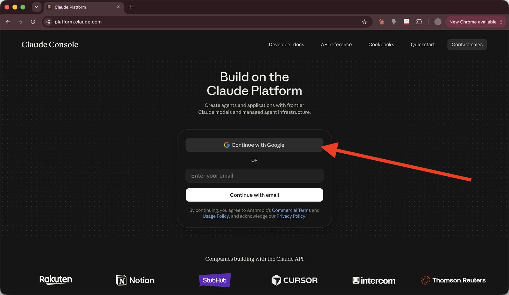
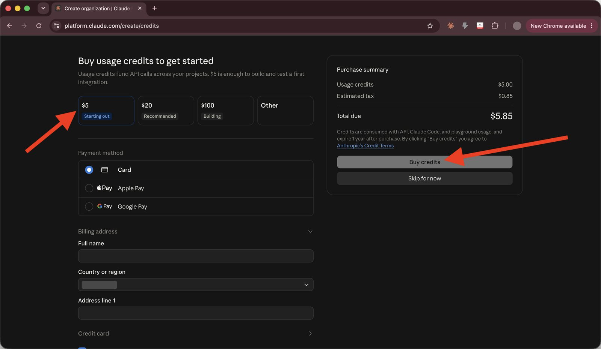
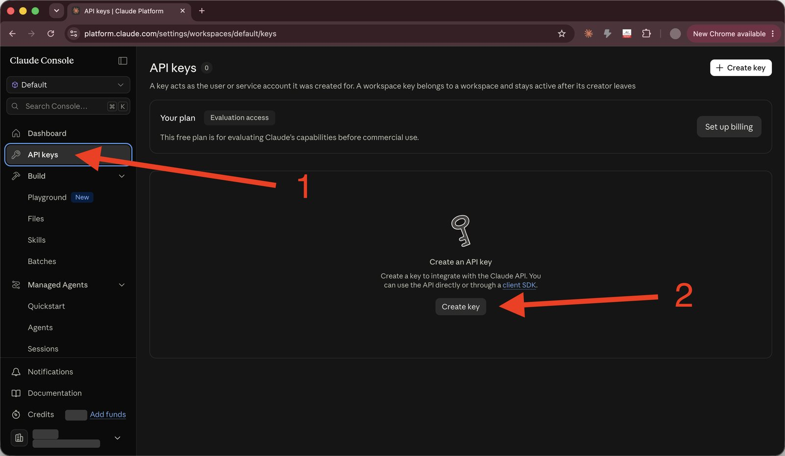
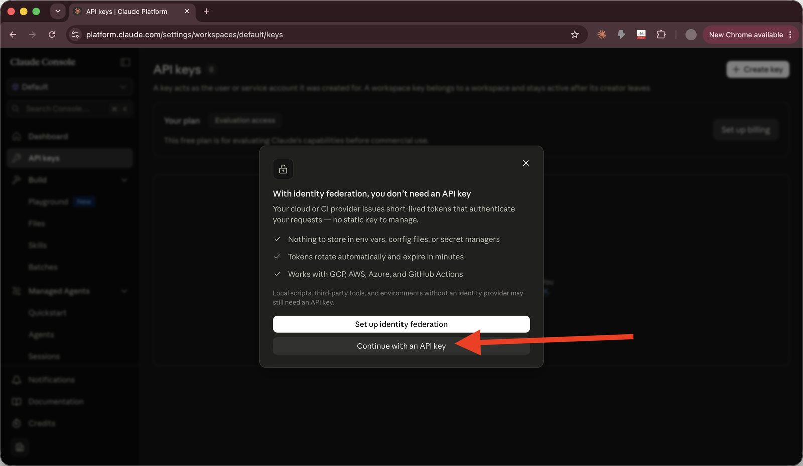
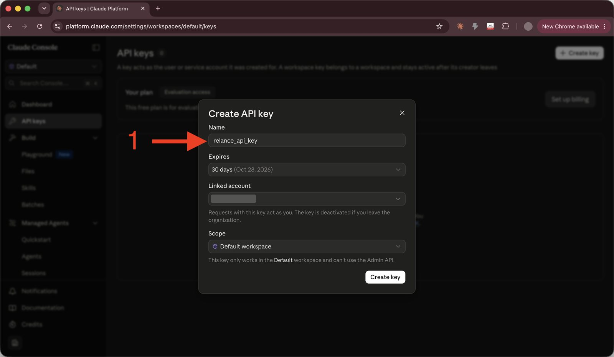
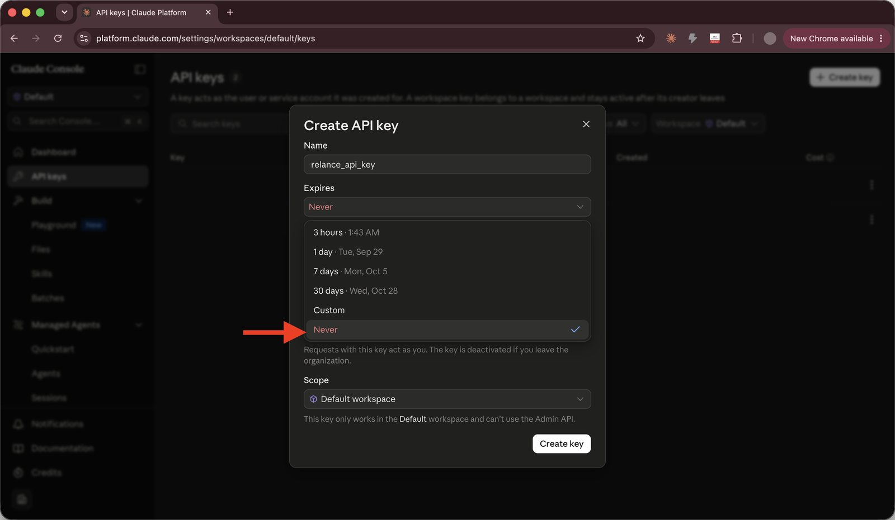
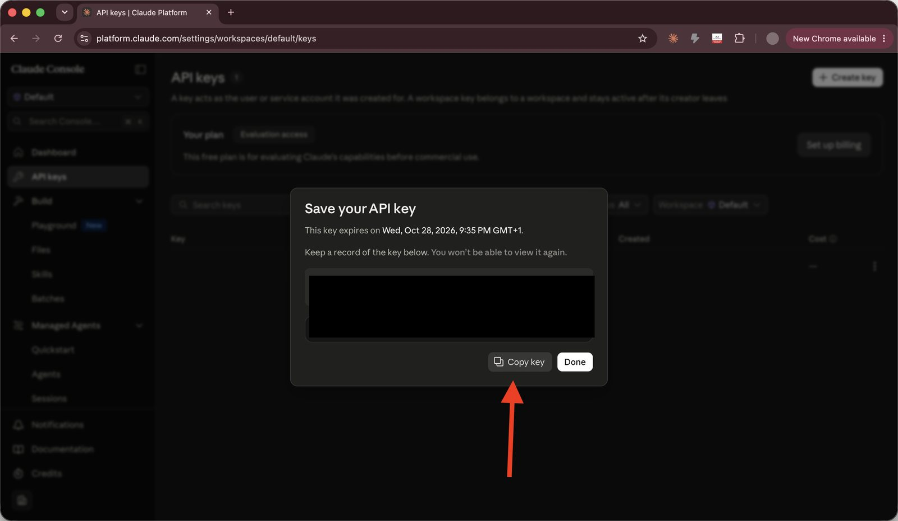
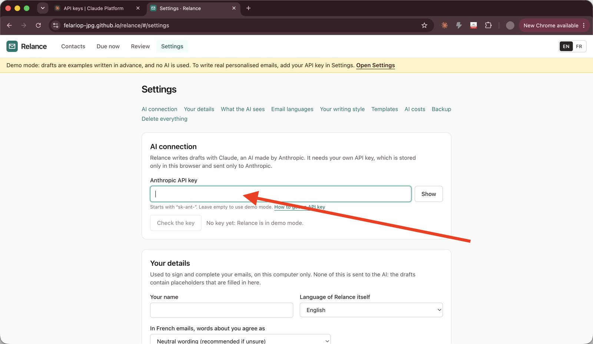

# Getting an API key

*Version française : [Obtenir une clé API](api-key.fr.md)*

## Why Relance needs one

Relance writes drafts with Claude, an AI made by the company Anthropic. Relance has no server and no account of its own, so it cannot pay for the AI on your behalf. Instead, you connect your own Anthropic account using a **key**: a long code that starts with `sk-ant-`. It works like a password that lets Relance ask Claude for drafts, billed to your account.

You don't need a key to try Relance. Without one it runs in **demo mode** with example drafts, and you can always write emails from the template text for free.

## You can look around first

You don't need a key, or any credit, to start. Without a key Relance runs in **demo mode**: you can import contacts, see who is due, and read example drafts. When you're ready for real drafts, come back to this guide. Anthropic also lets you create an account and skip buying credit until later.

## What it costs

- Relance is free.
- Anthropic charges for each draft the AI writes: **less than one euro cent per email** with the model Relance uses. $5 of credit covers roughly 500 emails.
- Anthropic charges in US dollars. Relance shows costs in euros using a fixed exchange rate, so its figures are close estimates; your Anthropic account shows the exact amount.
- Relance shows an estimate before each batch, the real cost afterwards, and a running total in **Settings → AI costs**.

Prices can change. Anthropic's own website shows the current prices.

## Getting a key, step by step

It takes about five minutes. You need an email address or a Google account.

1. Go to **platform.claude.com**. This is Anthropic's website for people who use their AI in other tools. Click **Continue with Google**, or type your email address and continue. If you don't have an account yet, this creates one.

   

2. Anthropic offers to sell you usage credits. Choose an amount, enter your card details and click **Buy credits**. $5 is plenty: at less than one euro cent per email, it lasts a long time. If you'd rather look around first, click **Skip for now** and add credits later under **Billing**. Relance can't write AI drafts until your account has credit.

   

3. In the menu on the left, click **API keys** (marked 1). Then click **Create key** (marked 2).

   

4. A window may offer "identity federation". That is for company cloud systems and doesn't apply to Relance. Click **Continue with an API key**.

   

5. In **Name**, type a name you'll recognise, for example "Relance". Leave the other fields as they are, except **Expires**: look at it now. It is set to **30 days**.

   

6. Open **Expires** and choose **Never**. **This matters.** If you keep 30 days, the key stops working after a month: Relance's drafts suddenly fail with "Your API key was not accepted", and nothing else tells you why. Then click the button to create the key.

   

7. Anthropic shows your new key **once only**. Click **Copy key**. If you close this window before copying it, delete that key and create a new one.

   

8. Go back to Relance and paste the key:
   - **If you're on the welcome screen**, paste it at step 2, **Connect the AI**, then click **Next**.

     

   - **Otherwise**, click **Settings**, paste it into **Anthropic API key** under **AI connection**, then click **Check the key**. You should see "The key works."

     

The yellow "Demo mode" banner disappears. Drafts are now written by the AI.

## Keeping the key safe

- **Your key never leaves your browser, except to go to Anthropic.** Relance stores it in this browser only. It is sent to Anthropic with each request, which is how Anthropic knows the request is yours. It is never sent anywhere else, and it is not included in Relance's backup files.
- **Don't share it.** Anyone with your key can use your credit.
- **Set a spending limit.** On platform.claude.com, under Billing or Limits, you can cap how much can be spent per month.
- **If you think someone else has your key**, go to **API keys** on platform.claude.com and delete it, then create a new one (with **Expires: Never**) and paste it into Relance.
- **On a shared computer**, remember that anyone who can open your browser can open Relance. To remove everything from that computer, use **Settings → Delete everything**.

## Something isn't working

| What you see | What to do |
|---|---|
| "This key was not accepted" | Copy the key again. It is long; make sure you copied all of it, with nothing before or after. |
| Drafts **suddenly** fail with "Your API key was not accepted", after working before | The key has probably **expired**. On platform.claude.com, open **API keys** and look at its expiry date. Create a new key with **Expires: Never**, and paste it into Relance under **Settings → AI connection**. |
| "Your Anthropic account has run out of credit" | Add credit under **Billing** on platform.claude.com. |
| "The AI service is overloaded" or "receiving too many requests" | Wait a few minutes, then click **Try again** on the draft. Relance already retries a few times by itself. |
| "Couldn't reach the AI service" | Check your internet connection, then click **Try again**. |
