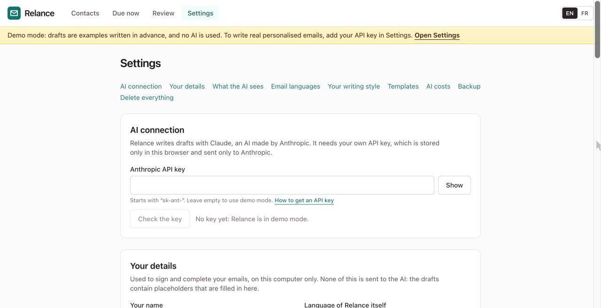

# Getting an API key

*Version française : [Obtenir une clé API](api-key.fr.md)*

## Why Relance needs one

Relance writes drafts with Claude, an AI made by the company Anthropic. Relance has no server and no account of its own, so it cannot pay for the AI on your behalf. Instead, you connect your own Anthropic account using a **key**: a long code that starts with `sk-ant-`. It works like a password that lets Relance ask Claude for drafts, billed to your account.

You don't need a key to try Relance. Without one it runs in **demo mode** with example drafts, and you can always write emails from the template text for free.

## What it costs

- Relance is free.
- Anthropic charges for each draft the AI writes. With the model Relance uses, one email costs roughly **one euro cent**. A batch of 50 emails is roughly 50 cents.
- Anthropic asks you to buy credit in advance. The smallest amount is a few euros, which is enough for hundreds of emails.
- Relance shows an estimate before each batch, the real cost afterwards, and a running total in **Settings → AI costs**.

Prices can change. Anthropic's own website shows the current prices.

## Getting a key, step by step

1. Go to **console.anthropic.com**. This is Anthropic's website for people who use their AI in other tools.
2. Create an account, or sign in if you already have one.
3. Open **Billing** (in the menu or under your account) and add credit. A few euros is enough to start.

   > TODO (screenshot): the Billing page in the Anthropic Console.

4. Open **API Keys**.
5. Click **Create Key**.
6. Give it a name you will recognise, for example "Relance".
7. Click to create it. The key is shown **only once**.
8. Click the copy button next to the key.

   > TODO (screenshot): a newly created key with its copy button.

9. Open Relance and click **Settings**.
10. Paste the key into **Anthropic API key**.
11. Click **Check the key**. You should see "The key works."

    

The yellow "Demo mode" banner disappears. Drafts are now written by the AI.

## Keeping the key safe

- **Your key never leaves your browser, except to go to Anthropic.** Relance stores it in this browser only. It is sent to Anthropic with each request, which is how Anthropic knows the request is yours. It is never sent anywhere else, and it is not included in Relance's backup files.
- **Don't share it.** Anyone with your key can use your credit.
- **Set a spending limit.** In the Anthropic Console, under Billing or Limits, you can cap how much can be spent per month.
- **If you think someone else has your key**, go to **API Keys** in the Console and delete it, then create a new one and paste it into Relance.
- **On a shared computer**, remember that anyone who can open your browser can open Relance. To remove everything from that computer, use **Settings → Delete everything**.

## Something isn't working

| What you see | What to do |
|---|---|
| "This key was not accepted" | Copy the key again. It is long; make sure you copied all of it, with nothing before or after. |
| "Your Anthropic account has run out of credit" | Add credit under **Billing** in the Console. |
| "The AI service is overloaded" or "receiving too many requests" | Wait a few minutes, then click **Try again** on the draft. Relance already retries a few times by itself. |
| "Couldn't reach the AI service" | Check your internet connection, then click **Try again**. |
