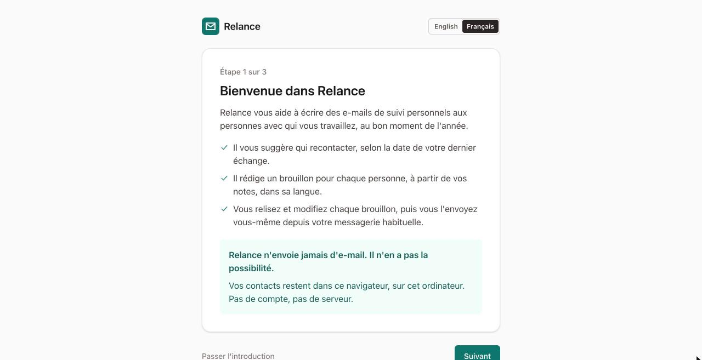
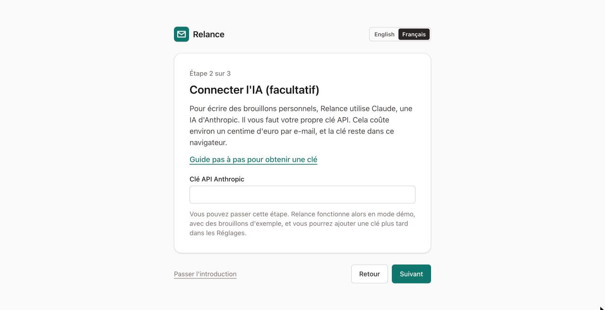
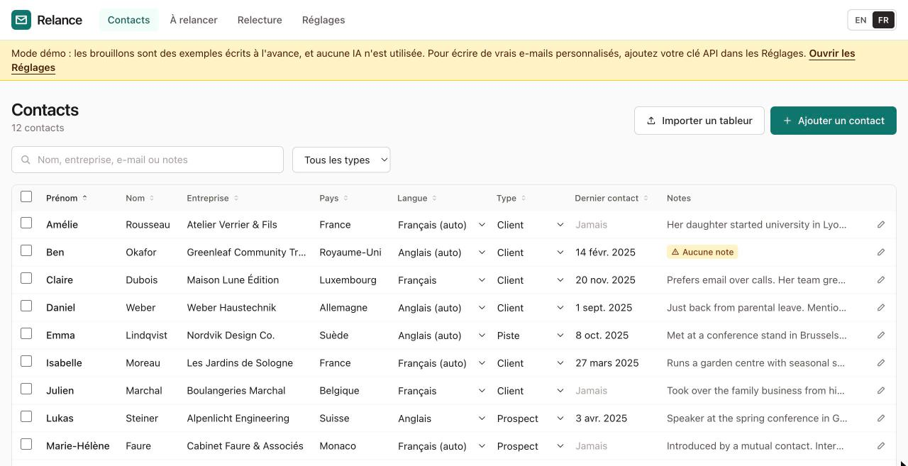

# Premiers pas avec Relance

Ce guide vous accompagne jusqu'à vos premiers e-mails de suivi. Comptez environ quinze minutes. Vous n'avez rien à installer.

*English version: [Getting started](getting-started.md)*

## Avant de commencer

- Un ordinateur avec un navigateur web récent : Chrome, Edge, Firefox ou Safari.
- Vos contacts dans un tableur (Excel, Numbers ou Google Sheets), si vous en avez un. Vous pouvez aussi ajouter les contacts un par un.
- Facultatif : une clé API Anthropic, pour des brouillons rédigés par l'IA. Le guide [Obtenir une clé API](api-key.fr.md) explique comment faire. Vous pouvez commencer sans.

## Partie 1 : Ouvrir Relance

1. Ouvrez votre navigateur web.
2. Allez sur **https://felariop-jpg.github.io/relance/**.
3. Ajoutez la page à vos favoris, pour la retrouver facilement.

   Ouvrez toujours Relance dans le même navigateur, sur le même ordinateur. Vos contacts sont enregistrés dans ce navigateur, pas en ligne.

4. En haut à droite, cliquez sur **Français** si l'écran est en anglais.
5. Lisez l'écran d'accueil. Il explique ce que fait Relance, et qu'il n'envoie jamais d'e-mail tout seul.

   

6. Cliquez sur **Suivant**.

## Partie 2 : Connecter l'IA (facultatif)

1. Si vous avez une clé API, collez-la dans le champ.

   

2. Cliquez sur **Suivant**.

   Si vous n'avez pas encore de clé, cliquez quand même sur **Suivant**. Relance fonctionne alors en mode démo : les brouillons sont des exemples écrits à l'avance. Vous pourrez ajouter une clé plus tard, dans les **Réglages**.

## Partie 3 : Ajouter vos contacts

Cet écran propose trois choix.

- **Pour essayer Relance d'abord :** cliquez sur **Charger les contacts d'exemple**. Vous obtenez douze personnes fictives, que vous pourrez supprimer ensuite.
- **Pour commencer avec une liste vide :** cliquez sur **Commencer avec une liste vide**, puis ajoutez les contacts un par un avec **Ajouter un contact**.
- **Pour importer votre tableur :** suivez les étapes ci-dessous.

### Importer un tableur

1. Ouvrez votre tableur dans Excel, Numbers ou Google Sheets.
2. Enregistrez une copie au format CSV :
   - Dans Excel : **Fichier → Enregistrer sous**, puis choisissez **CSV UTF-8**.
   - Dans Numbers : **Fichier → Exporter vers → CSV**.
   - Dans Google Sheets : **Fichier → Télécharger → Valeurs séparées par des virgules (.csv)**.
3. De retour dans Relance, cliquez sur **Importer un tableur**.
4. Cliquez sur **Choisir un fichier** et sélectionnez le fichier CSV que vous venez d'enregistrer.
5. Relance affiche chaque colonne de votre fichier avec quelques exemples. Vérifiez le choix **Mettre dans** de chaque colonne.
   - Relance propose un choix quand il reconnaît le nom d'une colonne. Vérifiez-les quand même.
   - Si une colonne contient les noms complets (« Anne Martin »), choisissez **Nom complet (séparé en prénom et nom)**.
   - Pour les colonnes inutiles, choisissez **Ne pas importer**.
   - Chaque contact doit avoir au moins un prénom.
6. Cliquez sur **Importer**. Relance indique combien de contacts ont été ajoutés, et si certains ont été ignorés (par exemple, la même adresse e-mail deux fois).

### Importer à nouveau la même liste

Si votre propre liste de contacts donne un numéro ou un code à chaque personne, mettez cette colonne dans **Identifiant du contact**. Quand vous importerez plus tard une version plus récente de la liste, Relance mettra à jour les contacts qu'il connaît déjà au lieu de les ignorer. Une cellule vide n'efface jamais ce que Relance contient déjà (vos notes sont conservées), et la date de dernier contact la plus récente est gardée. Les contacts importés avant que vous utilisiez un identifiant sont reconnus par leur adresse e-mail la première fois.

Pour récupérer vos contacts, cliquez sur **Exporter les contacts (CSV)** dans la page Contacts. Le fichier s'ouvre dans n'importe quel tableur, et Relance reconnaît toutes ses colonnes si vous l'importez à nouveau.

## Partie 4 : Vérifier vos contacts

1. Cliquez sur **Contacts** en haut de la page.

   

2. Regardez la colonne **Notes**. Une étiquette jaune **Aucune note** signifie que l'IA n'aura rien de personnel à dire sur cette personne.
3. Cliquez sur le prénom d'un contact pour l'ouvrir.
4. Dans **Notes**, écrivez ce que vous voudriez vous rappeler avant de lui écrire : ce dont vous avez parlé, ce qu'elle vit en ce moment, ce qu'elle a mentionné. C'est ce qui rend chaque e-mail personnel.
5. Pour les personnes à relancer un jour (une question restée sans réponse, une proposition en attente), renseignez **Resté en suspens**, par exemple « en attente de leur décision budgétaire » ou « doivent revenir vers nous au printemps ». C'est autour de cela que l'e-mail « Reprendre contact » est construit. S'il est vide, Relance laisse un passage entre [CROCHETS] à compléter vous-même plutôt que d'inventer.
6. Cliquez sur **Enregistrer**.

   La colonne **Langue** indique la langue de chaque personne. « (auto) » signifie que Relance l'a choisie d'après le pays. Pour la changer, choisissez une autre langue dans cette colonne.

## Partie 5 : Voir qui relancer

1. Cliquez sur **À relancer** en haut de la page.
2. Lisez la liste. Relance affiche les personnes concernées ce mois-ci par chaque modèle. Tout le monde est coché au départ. Si personne n'est concerné, la page l'indique et montre ce qui arrive dans les prochains mois.
3. Décochez les personnes à qui vous ne voulez pas écrire cette fois-ci.

   Si personne n'est à relancer ce mois-ci, ouvrez **Choisir les contacts vous-même** en bas de la page, cochez les personnes voulues et choisissez n'importe quel modèle.

4. Cliquez sur **Rédiger les brouillons**.
5. Choisissez comment écrire les e-mails :
   - **Écrire des e-mails personnels avec l'IA** : utilise vos notes. La fenêtre indique le coût approximatif.
   - **Utiliser le texte du modèle tel quel** : remplit seulement les noms et votre signature. Sans IA, sans frais.
6. Cliquez sur **Écrire … e-mails**. Relance ouvre la page **Relecture** et rédige les brouillons l'un après l'autre.

## Partie 6 : Relire les brouillons

1. Lisez le premier brouillon.

   

2. Regardez la ligne colorée au-dessus de l'objet. Elle indique quel détail de vos notes l'e-mail utilise. Une ligne **jaune** signifie que l'e-mail n'a pas pu être personnalisé, en général parce que le contact n'a pas de notes.
3. Cliquez dans l'objet ou le texte pour modifier ce que vous voulez. Vos modifications sont enregistrées au fur et à mesure.
4. Pour obtenir une autre version, cliquez sur **Réécrire**. Pour l'orienter, cliquez sur **Réécrire avec une consigne** et tapez par exemple « plus court » ou « mentionner l'atelier ».
5. Quand l'e-mail vous convient, cliquez sur **Valider**. Si vous ne voulez pas l'envoyer, cliquez sur **Écarter**.
6. Recommencez pour chaque brouillon.

   Pour vérifier ce que l'IA a reçu, ouvrez **Ce qui a été envoyé à l'IA** en bas d'un brouillon.

## Partie 7 : Envoyer vos e-mails

1. Cliquez sur **Exporter les brouillons validés** en bas de la page Relecture.
2. Laissez **Fichiers e-mail pour Outlook** sélectionné. (**Fichiers texte** sert de solution de repli si les fichiers e-mail ne s'ouvrent pas correctement.)
3. Cochez **Indiquer ces contacts comme contactés aujourd'hui** seulement si vous envoyez les e-mails aujourd'hui. Si vous les envoyez un autre jour, laissez la case décochée et indiquez la date ensuite dans la colonne **Dernier contact** de la page Contacts.
4. Cliquez sur **Télécharger**. Votre navigateur enregistre un fichier .zip, en général dans le dossier **Téléchargements**.
5. Ouvrez votre dossier **Téléchargements**.
6. Ouvrez le fichier .zip :
   - **Sous Windows :** faites un clic droit dessus et choisissez **Extraire tout…**, puis **Extraire**. (Ouvrir les e-mails depuis la fenêtre du .zip peut les rendre non modifiables.)
   - **Sur Mac :** double-cliquez dessus.
7. Double-cliquez sur le premier fichier e-mail.

   > TODO (capture d'écran) : un brouillon exporté ouvert dans Outlook, prêt à être envoyé.

   - **Outlook pour Windows** l'ouvre comme un nouveau message, prêt à être envoyé.
   - **Apple Mail** l'ouvre comme un message reçu. Choisissez **Message → Renvoyer** pour en faire un nouvel e-mail.
   - **Thunderbird** : choisissez **Message → Modifier en tant que nouveau message**.
   - Dans les autres messageries, copiez le texte dans un nouvel e-mail.
   - Si les fichiers ne s'ouvrent pas correctement dans votre messagerie, exportez à nouveau en choisissant **Fichiers texte** : un fichier texte par e-mail, prêt à copier-coller.

8. Relisez une dernière fois, puis cliquez sur **Envoyer**.
9. Recommencez pour chaque fichier e-mail.

## Partie 8 : Faire une sauvegarde

Vos contacts n'existent que dans ce navigateur. Si les données du navigateur sont effacées, ils disparaissent.

1. Cliquez sur **Réglages**.
2. Descendez jusqu'à **Sauvegarde**.
3. Cliquez sur **Télécharger une sauvegarde**. Gardez le fichier en lieu sûr, par exemple dans vos documents ou votre stockage en ligne.
4. Recommencez de temps en temps. Relance vous le rappelle quand vous avez plus de 50 contacts et aucune sauvegarde récente.

## Pour aller plus loin

- [Obtenir une clé API](api-key.fr.md) : pour des brouillons rédigés par l'IA.
- [Modifier les modèles](templates.fr.md) : pour changer la formulation.
- [Confidentialité](../PRIVACY.fr.md) : ce qui est envoyé, et où, en termes simples.
