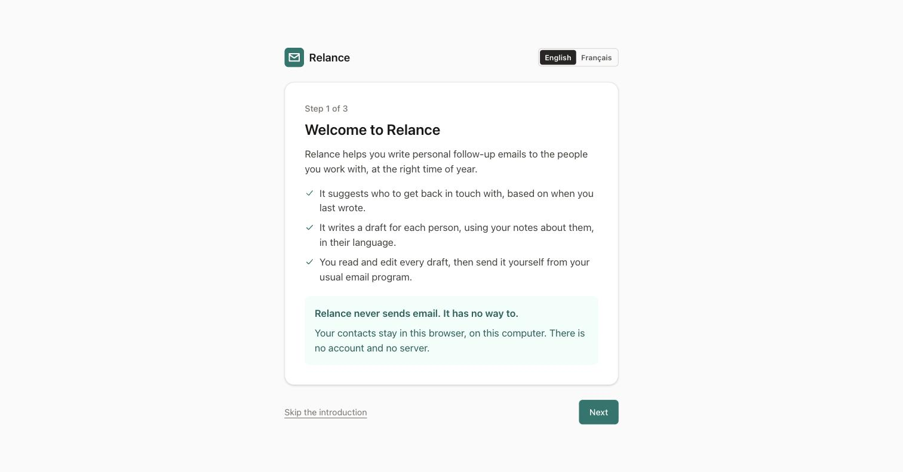
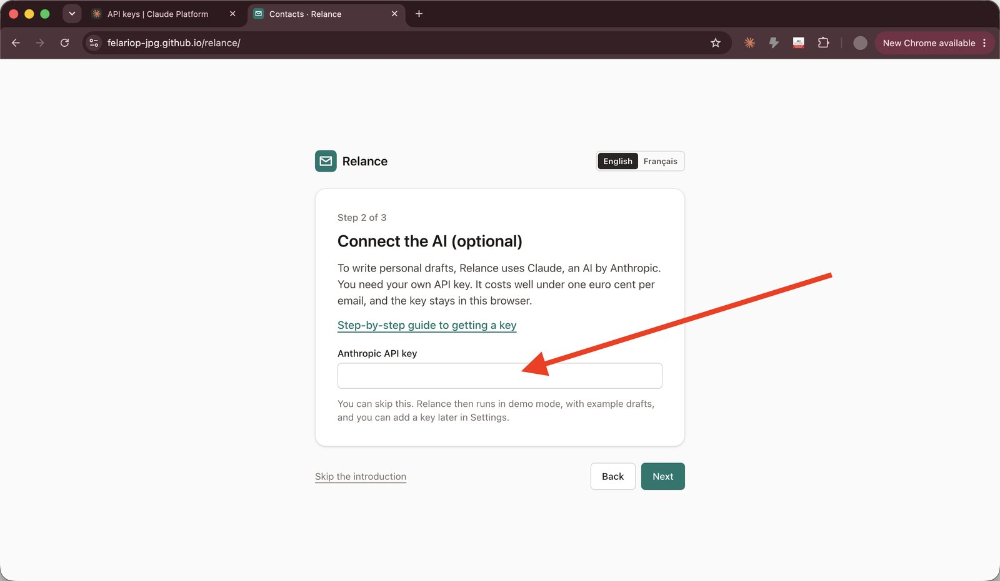
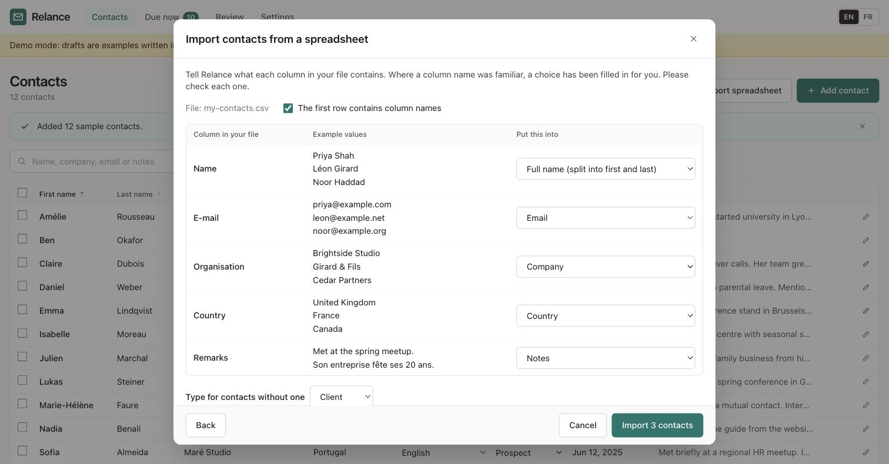
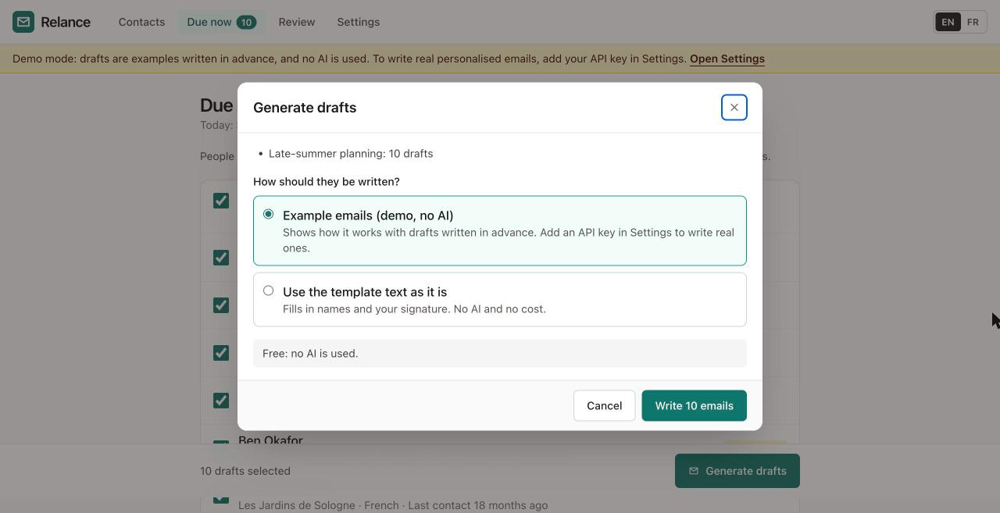
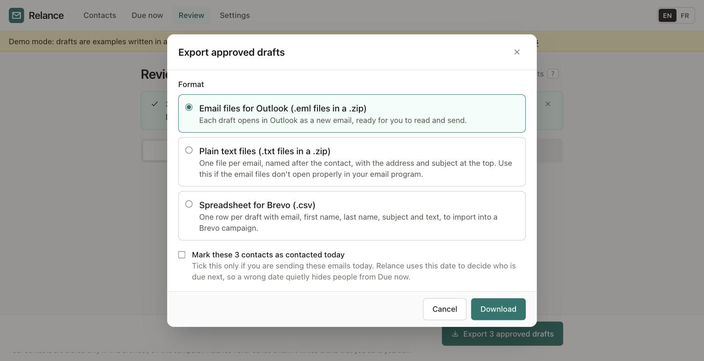

# Getting started with Relance

This guide takes you from nothing to your first follow-up emails. It takes about fifteen minutes. You do not need to install anything.

*Version française : [Premiers pas](getting-started.fr.md)*

## Before you start

- A computer with a recent web browser: Chrome, Edge, Firefox or Safari.
- Your contacts in a spreadsheet (Excel, Numbers or Google Sheets), if you have one. You can also add contacts one by one.
- Optional: an Anthropic API key, for AI-written drafts. The guide [Getting an API key](api-key.md) explains how. You can start without one.

## Part 1: Open Relance

1. Open your web browser.
2. Go to **https://felariop-jpg.github.io/relance/**.
3. Add the page to your bookmarks, so you can find it again.

   Always open Relance in the same browser on the same computer. Your contacts are stored in that browser, not online.

4. Read the welcome screen. It explains what Relance does, and that it never sends email by itself.

   

5. Click **Next**.

## Part 2: Connect the AI (you can skip this)

1. If you have an API key, paste it into the box.

   

2. Click **Next**.

   If you don't have a key yet, click **Next** anyway. Relance then runs in demo mode: the drafts are examples written in advance. You can add a key later, in **Settings**.

## Part 3: Add your contacts

You have three choices on this screen.

- **To try Relance first:** click **Load sample contacts**. You get twelve made-up people. You can delete them later.
- **To start empty:** click **Start with an empty list**, then add contacts one by one with **Add contact**.
- **To import your spreadsheet:** follow the steps below.

### Importing a spreadsheet

1. Open your spreadsheet in Excel, Numbers or Google Sheets.
2. Save a copy as a CSV file:
   - In Excel: **File → Save As**, then choose **CSV UTF-8**.
   - In Numbers: **File → Export To → CSV**.
   - In Google Sheets: **File → Download → Comma-separated values (.csv)**.
3. Back in Relance, click **Import a spreadsheet**.
4. Click **Choose a file** and pick the CSV file you just saved.
5. Relance shows every column of your file, with a few example values. Check the **Put this into** choice for each column.

   

   - Relance fills in a choice when it recognises a column name. Check each one anyway.
   - If a column holds full names ("Anne Martin"), choose **Full name (split into first and last)**.
   - For columns you don't need, choose **Don't import**.
   - Every contact needs at least a first name.

6. Click **Import**. Relance tells you how many contacts were added, and whether any were skipped (for example, the same email address twice).

### Importing the same list again

If your own contact list gives each person a number or code, put that column into **Contact ID**. When you import a newer copy of the list later, Relance updates the contacts it already has instead of skipping them. Empty cells never erase what Relance already holds (your notes are safe), and the more recent "last contacted" date is kept. Contacts you imported before you used a Contact ID are matched by email address the first time.

To take your contacts back out, click **Export contacts (CSV)** on the Contacts page. The file opens in any spreadsheet program, and Relance recognises every column if you import it again.

## Part 4: Check your contacts

1. Click **Contacts** at the top of the page.

   

2. Look at the **Notes** column. A yellow **No notes** label means the AI will have nothing personal to say about that person.
3. Click a contact's name to open it.
4. In **Notes**, write what you would want to remember before emailing them: what you talked about, what is happening for them, anything they mentioned. This is what makes each email personal.
5. For people you might re-engage (a question you never answered, a proposal on hold), fill in **Left open**, for example "waiting on their budget decision" or "said they'd come back to us in the spring". This is what the re-engagement email is built around. If it's empty, Relance leaves a gap in [SQUARE BRACKETS] for you to fill in by hand rather than inventing something.
6. Click **Save**.

   The **Language** column shows which language each person will get. "(auto)" means Relance chose it from the country. To change it, pick another language in that column.

## Part 5: See who is due

1. Click **Due now** at the top of the page.

   

2. Read the list. Relance shows the people each template is meant for this month. Everyone is ticked to start with. If nobody is due, the page says so and lists what is coming up in the next months (as in the picture above).
3. Untick anyone you don't want to write to this time.

   If nobody is due this month, open **Choose contacts yourself** at the bottom of the page, tick the people you want, and pick any template.

4. Click **Generate drafts**.
5. Choose how the emails should be written:
   - **Write personal emails with AI**: uses your notes. The window shows roughly what it will cost.
   - **Use the template text as it is**: fills in names and your signature only. No AI, no cost.

   

6. Click **Write … emails**. Relance opens the **Review** page and writes the drafts one after another.

## Part 6: Review the drafts

1. Read the first draft.

   

2. Look at the coloured line above the subject. It says which detail from your notes the email uses. A **yellow** line means the email could not be personal, usually because the contact has no notes.
3. Click into the subject or the text to change anything. Your changes are saved as you type.
4. If you would like a different version, click **Rewrite**. To steer it, click **Rewrite with an instruction** and type something like "shorter" or "mention the workshop".
5. When the email is right, click **Approve**. If you don't want to send it, click **Skip**.
6. Repeat for each draft.

   If you want to check what the AI received, open **What was sent to the AI** at the bottom of a draft.

## Part 7: Send your emails

1. Click **Export approved drafts** at the bottom of the Review page.

   

2. Leave **Email files for Outlook** selected. (**Plain text files** is there as a fallback if the email files don't open properly.)
3. Tick **Mark these contacts as contacted today** only if you will send the emails today. If you send them another day, leave it unticked and set the date afterwards in the **Last contacted** column on the Contacts page.
4. Click **Download**. Your browser saves a .zip file, usually in your **Downloads** folder.
5. Open your **Downloads** folder.
6. Open the .zip file:
   - **On Windows:** right-click it and choose **Extract All…**, then **Extract**. (Opening the emails from inside the .zip window can make them read-only.)
   - **On a Mac:** double-click it.
7. Double-click the first email file.

   > TODO (screenshot): an exported draft open in Outlook, ready to send.

   - **Outlook for Windows** opens it as a new message, ready to send.
   - **Apple Mail** opens it as a message you received. Choose **Message → Send Again** to turn it into a new email.
   - **Thunderbird**: choose **Message → Edit as New Message**.
   - In other email programs, copy the text into a new email.
   - If the files don't open properly in your email program, export again and choose **Plain text files** instead: one text file per email, ready to copy and paste.

8. Read it one last time, then click **Send**.
9. Repeat for each email file.

## Part 8: Keep a backup

Your contacts exist only in this browser. If the browser's stored data is cleared, they are gone.

1. Click **Settings**.
2. Scroll to **Backup**.
3. Click **Download a backup**. Keep the file somewhere safe, for example in your documents or cloud storage.
4. Do this again from time to time. Relance reminds you when you have more than 50 contacts and no recent backup.

## Where to go next

- [Getting an API key](api-key.md): for AI-written drafts.
- [Editing templates](templates.md): to change the wording.
- [Privacy](../PRIVACY.md): what is sent where, in plain words.
